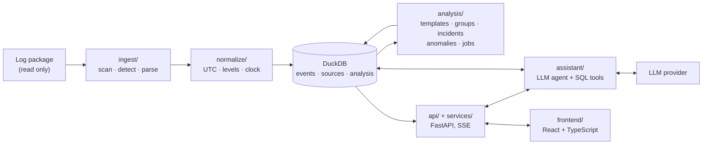

# Log Tracer

**AI-assisted log analysis for distributed PLM systems.** Log Tracer ingests the logs of 14 servers in six formats into DuckDB without touching the originals. It groups errors, detects anomalies and correlates them across systems. A language model then explains root causes as hypotheses, and every claim cites the log file and line it comes from.

Built by our team for the challenge *"Automated log file management with an AI assistant"* at the **MAIT Makeathon 2026**.

| | |
|---|---|
| **Data** | 14 servers (7 Linux, 7 Windows), 13,643 log files (5,068 unique), ~1.67 M events |
| **Formats** | key=value `.log`, `.txt` with JSON payload, `;`-separated `.csv` with multi-line stack traces, `.jsonl` / `.jsonl.gz`, `.xml`, free-text `import_*.log` |
| **Stack** | Python 3.12 · FastAPI · DuckDB · Drain3 · React · TypeScript · Vite · Mantine |
| **LLM providers** | Claude, Gemini, Groq, KI:connect.nrw (OpenAI-compatible) |

Demo video: [docs/demo/Log Tracer – Demo.mp4](docs/demo/Log%20Tracer%20%E2%80%93%20Demo.mp4) · Pitch deck: [docs/Log Tracer – Pitch 5 Minuten.pptx](docs/Log%20Tracer%20%E2%80%93%20Pitch%205%20Minuten.pptx)

---

## Contents

- [The problem](#the-problem)
- [What Log Tracer does](#what-log-tracer-does)
- [Results on the challenge data](#results-on-the-challenge-data)
- [Quick start](#quick-start)
- [Configuration](#configuration)
- [Architecture](#architecture)
- [Analysis pipeline](#analysis-pipeline)
- [AI assistant](#ai-assistant)
- [HTTP API](#http-api)
- [Development](#development)
- [Project documentation](#project-documentation)
- [Team](#team)
- [License](#license)

---

## The problem

A single CAD conversion job touches Teamcenter, the dispatcher, NX/JT translators, the file management system (FMS) and the database. Each of these systems writes its own logs, in its own format, on its own host and sometimes with a skewed clock. When a job fails, the visible error is often far away from the cause. For example, a converter reports success, the upload to the FMS is rejected, and only the publish step finally fails. Finding the cause means opening dozens of files on several servers and aligning their timestamps by hand.

## What Log Tracer does

1. **Ingests** every log file of the package into DuckDB: one event per log record. Multi-line stack traces, a Windows-1252 file, gzip archives and lines without a date are all handled. Each event keeps its origin (`source_id`, `line_start`, `line_end`, `raw`). Byte-identical copies are detected by SHA-256 and parsed only once. Unparseable lines are stored with a `parse_error` and never dropped.
2. **Normalizes** timestamps to UTC (the original is kept in `ts_raw`), levels to `DEBUG | INFO | WARN | ERROR | FATAL`, and applies declared clock offsets.
3. **Analyzes** the events: message templates, error groups, cross-system correlations, incidents with a trigger and a causal chain, volume anomalies and a job index (see [Analysis pipeline](#analysis-pipeline)).
4. **Explains** with an LLM agent that queries the database through bounded tools. Answers are hypotheses with a causal chain, cited evidence, uncertainty, counter-evidence and verification steps. The backend rejects any cited event ID that does not exist.
5. **Presents** everything in a web UI:

| View | Purpose |
|---|---|
| **Overview / Process monitor** | Key figures, latest incidents and all jobs with status, servers, first problem and a link to the incident |
| **Timeline** | Full-text and filtered search over all events, with optional duplicate lines; opens any event with its surrounding lines from the original file |
| **Incidents** | Incidents with trigger, causal chain and a dependency graph across hosts and components |
| **Assistant** | Chat with streamed tool steps, a natural answer above the structured analysis, follow-up questions and context-aware suggestions |
| **Data sources** | All servers, formats and files, including identical copies, as proof that the whole package was ingested |

The UI runs in three modes: **Live** (backend API), **Demo** (built-in sample data, no backend needed) and **Import** (a ZIP of logs parsed in the browser).

## Results on the challenge data

Measured on the full log package (Windows 11, single process):

| Metric | Value |
|---|---|
| Full ingest | 1,673,792 events in ~53 s, 0 unparsed lines, 0 events without timestamp |
| Coverage | All 13,643 log files present with identical SHA-256; every non-empty line of the 5,068 unique files belongs to an event (except 48 CSV headers and 70 XML wrapper lines) |
| Analysis (full pipeline) | ~1.4 s |
| Incidents | 39, including all 10 known `INC-01` … `INC-10`, each with the correct trigger |
| Anomalies | 21 |
| Jobs | 52,226: 209 failed (every one linked to an incident), 7 warning, 802 recovered, 51,208 ok |
| API latency | List and detail endpoints typically under 50 ms |
| Assistant | Root cause of `JOB-2003` and `JOB-2010` found with cited evidence in about 20–35 s (KI:connect, `gpt-oss-120b`) |

## Quick start

### Prerequisites

| Tool | Version |
|---|---|
| Git with Git LFS | Git for Windows ships Git LFS |
| Python | 3.12 |
| [uv](https://docs.astral.sh/uv/) | installed with `python -m pip install --user uv` |
| Node.js | 22 or 24 LTS |

The log package `MAIT_Makeathon_Logpaket.zip` (~83 MB) is versioned with Git LFS.

### Run the whole app with one command (Windows)

```powershell
git lfs install
git clone https://github.com/soezbay/mait-log-tracer-makeathon-2026.git
cd mait-log-tracer-makeathon-2026
.\dev
```

`.\dev` creates `backend/.env` from the example if it is missing, installs the frontend packages on the first run, starts the backend on `:8000`, waits for `/api/health`, starts Vite on `:5173` and opens the browser. `Ctrl+C` stops both.

| Option | Effect |
|---|---|
| `.\dev -NoBrowser` | Do not open the browser |
| `.\dev -Install` | Run `npm install` again |

**First start:** the backend extracts the log package (~1 min). If the database is empty, start the ingest with `POST /api/ingest` (for example from the OpenAPI page at `/docs`) or with `scripts/ingest.py` while the backend is stopped. The analysis runs automatically after each ingest. Later starts take seconds; the state is kept under `data/`.

### Run backend and frontend separately

```powershell
cd backend
python -m uv sync
copy .env.example .env
python -m uv run logtracer          # API on http://localhost:8000, OpenAPI docs at /docs
```

```powershell
cd frontend
npm install --no-package-lock
npm run dev                         # http://localhost:5173, proxies /api to :8000
```

### Command-line tools

Run these from `backend/` while the API server is **stopped**, because only one process may write the DuckDB file.

| Command | Purpose |
|---|---|
| `python -m uv run python scripts/ingest.py` | Full ingest followed by the analysis |
| `python -m uv run python scripts/ingest.py --scan-only` | File scan only: duplicates, encodings |
| `python -m uv run python scripts/ingest.py --parse-dry-run` | Scan plus format and parser statistics, nothing written |
| `python -m uv run python scripts/make_fixture.py` | Small test database from the demo scenarios (seconds) |
| `python -m uv run python scripts/ask.py "Why did JOB-2003 fail?"` | Ask the assistant from the terminal |
| `python -m uv run python scripts/ask.py --list-models` | List the KI:connect deployments |

## Configuration

All settings live in `backend/.env`; [backend/.env.example](backend/.env.example) documents every value and its default. Relative paths resolve against `backend/`.

| Setting | Default | Meaning |
|---|---|---|
| `LOG_ROOT` | `../MAIT_Makeathon_Logpaket` | Extracted log package (read only) |
| `DB_PATH` | `../data/logtracer.duckdb` | Derived database, rebuildable at any time |
| `AUTO_DOWNLOAD` / `AUTO_EXTRACT` | `true` | Fetch the ZIP with `git lfs pull` and extract it on start if needed |
| `AUTO_ANALYSIS` | `true` | Rebuild the analysis after each ingest and on start if missing |
| `WATCH_ENABLED` | `false` | Ingest new or changed log files continuously |
| `LLM_PROVIDER` | `claude` | `claude`, `gemini`, `groq` or `kiconnect` |
| `LLM_MODEL` | `claude-sonnet-5-5` | Model ID, or deployment name for KI:connect |
| `ANTHROPIC_API_KEY`, `GEMINI_API_KEY`, `GROQ_API_KEY`, `KICONNECT_API_KEY` | empty | Key for the selected provider |

> **Secrets:** API keys belong only in `backend/.env`, which is git-ignored. They are never sent to the frontend.

Without an API key the whole application works except the assistant's answers.

## Architecture



**Principles**

- The original log files are never modified. Everything under `data/` is derived and can be rebuilt by a script.
- One backend process writes the database: API, ingest, analysis and file watcher run together. Each request gets its own DuckDB cursor.
- SQL lives only in `storage/repositories/`; routers and services contain none.
- Bulk inserts go through PyArrow in batches of 50,000 events.
- Frontend and backend communicate only over the HTTP API. Long-running work streams progress over Server-Sent Events.

### Repository layout

```
backend/
  src/logtracer/
    api/          FastAPI routers (all under /api)
    services/     application logic between API and storage
    ingest/       scanner, format detection, parsers, watcher
    normalize/    timestamps, levels, clock offsets
    storage/      DuckDB connection, schema.sql, repositories
    analysis/     templates, error groups, correlation, incidents, anomalies, jobs
    assistant/    LLM agent, tools, prompts, answer model, providers
    core/         settings, log package download and extraction
  scripts/        ingest, fixture database, command-line assistant
  tests/          pytest suite with real sample lines from the package
frontend/src/     React views, API client, i18n (English and German)
contracts/examples/   example JSON for each API endpoint
docs/             architecture, plan, change logs, pitch deck, demo video
scripts/dev.ps1   one-command start (called by dev.cmd)
```

## Analysis pipeline

The analysis runs in one transaction and rebuilds all derived tables in about 1.4 s.

| Step | Module | What it does |
|---|---|---|
| 1. Clock | `normalize/clock.py` | Applies declared clock offsets such as `clock_offset_seconds: -94` |
| 2. Templates | `analysis/templates.py` | Drain3 clustering of number-masked messages into templates |
| 3. Problems | `analysis/problems.py` | Separates real problems from noise: a message counts as a problem only if at least 10 % of its lines are WARN or worse |
| 4. Error groups | `analysis/error_groups.py` | Groups problems by message, host and component; a gap of 2 h starts a new group. Groups whose messages report a recovery (e.g. *"Transient retry recovered"*) get the status `recovered` |
| 5. Correlations | `analysis/correlation.py` | Links groups that share a trace or job ID within 300 s (hard links), and groups without IDs that follow each other within 15 s (soft links) |
| 6. Incidents | `analysis/incidents.py` | Connected groups form an incident; the trigger is the server named as `dependency=`, otherwise the earliest group. Incidents made only of recovered groups are dropped |
| 7. Anomalies | `analysis/anomalies.py` | Error volume per 10-minute window compared with the previous 24 h; consecutive spikes are merged |
| 8. Jobs | `analysis/jobs.py` | One row per job: a job number within a trace, otherwise split at a 30-minute pause; re-runs `-Rnn` count as one job; status comes from real problems only |

## AI assistant

The assistant is a tool-calling agent. The model never receives whole log files: it reads data only through tools that run bounded SQL queries (`LIMIT`) over events, traces, incidents, error groups and file context.

**Answer format** ([assistant/answer.py](backend/src/logtracer/assistant/answer.py)):

| Field | Content |
|---|---|
| `reply` | Natural answer to the question, in the user's language |
| `summary` | The root-cause hypothesis |
| `causal_chain` | Ordered steps from trigger to visible failure |
| `evidence` | Cited event IDs with file and line, validated by the backend |
| `uncertainty`, `counter_evidence` | What is not proven and what speaks against the hypothesis |
| `verification_steps` | How an engineer can confirm the cause |

Further properties:

- Answers stream over SSE, including each tool step, so the UI shows the agent's work as a timeline.
- Follow-up questions keep the conversation context and may cite evidence from earlier turns.
- Every LLM call is recorded in the `llm_calls` table with tokens, duration and cost.
- Suggested questions adapt to the opened event or job; recent and favorite questions are kept per browser.

## HTTP API

All routes are under `/api`. Times are ISO-8601 UTC with `Z`, and lists are paginated as `{items, total, limit, offset}`. The interactive OpenAPI documentation is served at `http://localhost:8000/docs`, and example responses are in [contracts/examples/](contracts/examples/).

| Method | Path | Purpose |
|---|---|---|
| `GET` | `/health` | Status, version, log package and database found |
| `GET` | `/stats` | Totals: servers, files, copies, events per level, duplicates, time range |
| `GET` | `/sources`, `/sources/summary` | Ingested files including identical copies; package summary |
| `GET` | `/events` | Filtered, paginated event search |
| `GET` | `/events/{id}`, `/events/{id}/context` | One event; its surrounding lines from the original file |
| `GET` | `/jobs`, `/jobs/{id}`, `/jobs/{id}/events` | Job index with status, servers, first problem and incident |
| `GET` | `/trace/{key}` | All events of a trace or job ID across systems |
| `POST` | `/ingest` | Start a full ingest |
| `GET` | `/ingest/status`, `/ingest/progress` | Ingest state; live progress over SSE |
| `GET` | `/analysis/status`, `/analysis/stats` | Analysis state and figures |
| `POST` | `/analysis/run` | Rebuild the analysis |
| `GET` | `/analysis/incidents`, `/analysis/incidents/{id}` | Incidents with trigger and causal chain |
| `GET` | `/analysis/groups`, `/analysis/anomalies`, `/analysis/graph` | Error groups, anomalies, dependency graph |
| `GET` | `/suggestions` | Context-aware question suggestions |
| `POST` | `/chat` | Ask the assistant (SSE stream, read with `fetch`) |
| `GET` | `/chat/{conversation_id}` | Conversation history |

## Development

```powershell
cd backend
python -m uv run pytest             # test suite
python -m uv run ruff check .       # lint (line length 100)
```

```powershell
cd frontend
npm run build                       # type check and production build
```

- Parser tests use real sample lines from the package: multi-line CSV, the Windows-1252 file, `.gz`, time-only free text and unparseable lines.
- `main` is the only shared branch; larger changes use short-lived `p<N>/<topic>` branches that are merged back the same day.
- `pytest` and `ruff check` must pass before every push.
- Every change is recorded in [docs/AI_LOG.md](docs/AI_LOG.md) (one line) and [docs/WORKLOG.md](docs/WORKLOG.md) (details).

Rules for contributors and AI coding agents, including ownership and the frozen interfaces, are in [AGENTS.md](AGENTS.md).

## Project documentation

| Document | Content |
|---|---|
| [docs/ARCHITECTURE.md](docs/ARCHITECTURE.md) | Components, data model, flows, API contract, architecture decisions |
| [docs/plan.en.md](docs/plan.en.md) | Project plan, roles, milestones, deferred decisions |
| [AGENTS.md](AGENTS.md) | Engineering rules, Git workflow, data quick reference |
| [contracts/examples/](contracts/examples/) | Example request and response for each endpoint |
| [docs/AI_LOG.md](docs/AI_LOG.md), [docs/WORKLOG.md](docs/WORKLOG.md) | Change history |

## Team

| Role | Member |
|---|---|
| Ingest, storage and API | Safak Özbay |
| Analysis and correlation | Harsh Singla |
| AI assistant | Tarun Chandubhai Surani |
| Frontend | Adnan Badra |

## License

Copyright © 2026 the Log Tracer team. **All rights reserved.** This repository is public only so that it can be viewed and evaluated at the MAIT Makeathon 2026; see [LICENSE](LICENSE).

The log package, the MAIT name and branding, and third-party libraries are not covered by this notice and remain the property of their owners.
