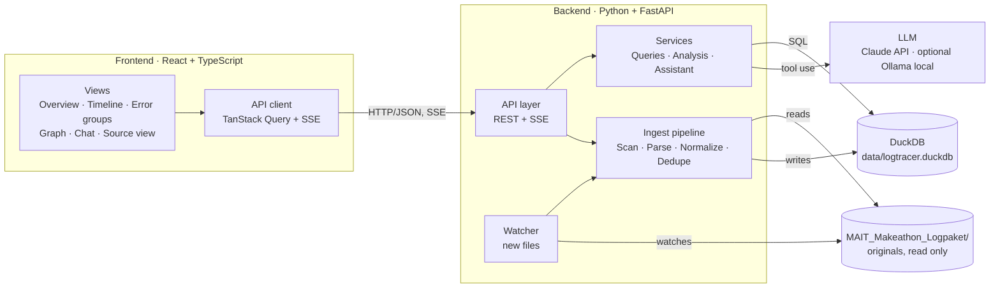
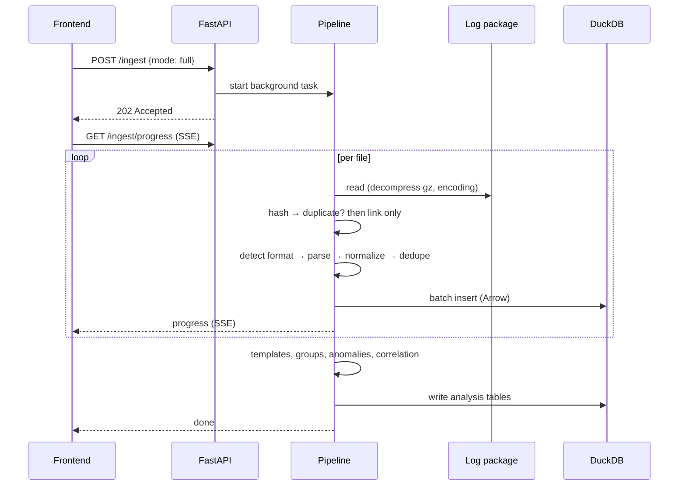
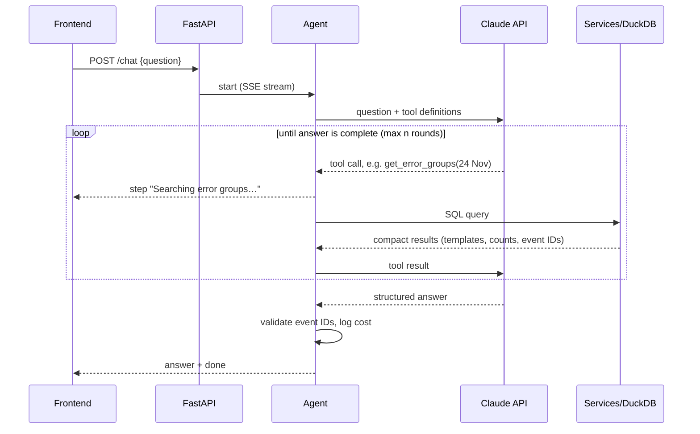
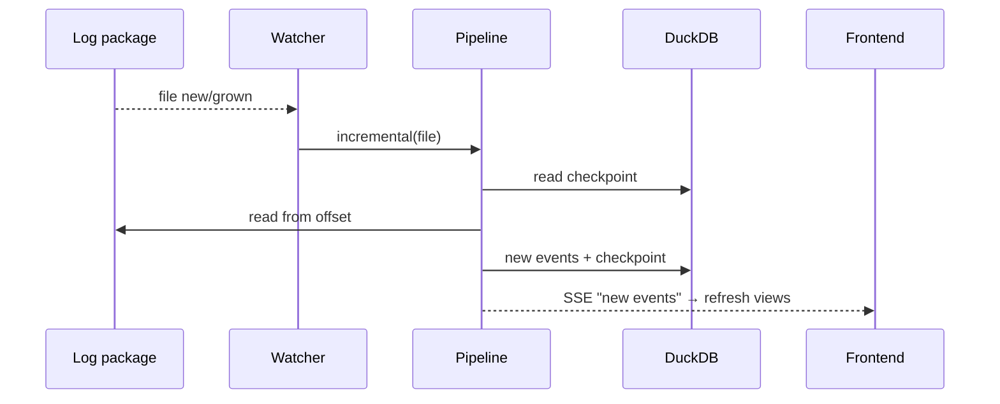
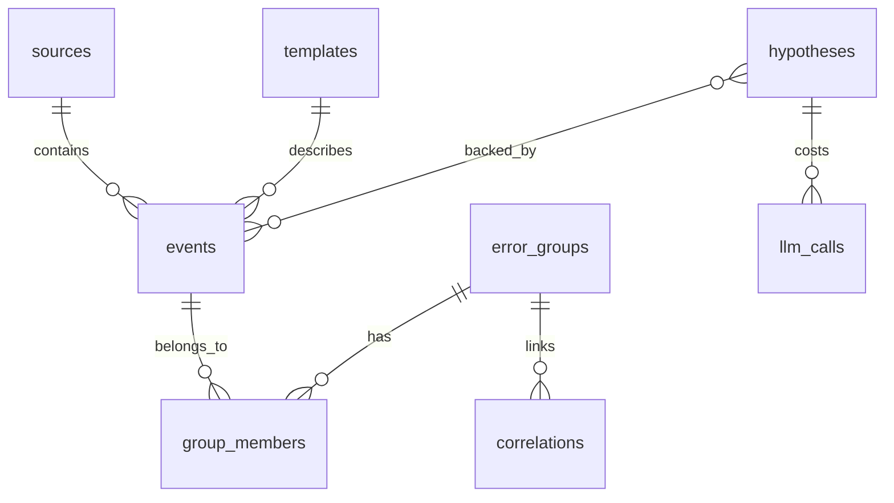

# Architecture: Log Tracer

> AI log assistant for the MAIT challenge · Status: 2026-11-23 (day 1, draft)
> Related: [plan.en.md](../plan.en.md) · German version: [ARCHITEKTUR.md](ARCHITEKTUR.md) · Data: `MAIT_Makeathon_Logpaket/` (read only)

---

## 1. Overview

Log Tracer consists of **two separate applications** that talk to each other only through an HTTP API:

| | **Frontend** | **Backend** |
|---|---|---|
| Responsibility | presentation & interaction | ingest data, analyze, generate AI answers |
| Technology | React + TypeScript (Vite) | Python + FastAPI |
| Runs on | browser (dev server port `5173`) | server process (port `8000`) |
| Knows about | only the API (`/api/...`) | log files, DuckDB, LLM |
| State | none (UI state only) | DuckDB file, checkpoints |

The frontend **never** accesses log files, DuckDB or the LLM directly. The LLM API key lives in the backend only.



### Architecture principles

1. **Originals stay untouched.** Log files are only read. Everything derived lives in DuckDB and can be rebuilt at any time.
2. **Every statement has evidence.** Every event knows its file and line. The assistant may only name causes it can back with event IDs.
3. **The LLM never reads everything.** It fetches context selectively via tools (SQL queries). This reduces cost and hallucinations.
4. **Explainable analysis before black boxes.** Error groups, anomalies and correlation are rule-based or statistical and therefore traceable.
5. **Clear interface.** Frontend and backend share only the API contract (OpenAPI). Both teams can work in parallel.

---

## 2. Frameworks & libraries

### 2.1 Backend (Python 3.11+)

| Framework / library | What it is | What we use it for |
|---|---|---|
| **FastAPI** | web framework for APIs | REST endpoints, automatic OpenAPI docs at `/docs`, request validation |
| **Uvicorn** | ASGI server | runs the FastAPI app |
| **Pydantic v2** + **pydantic-settings** | data models with validation | API schemas (request/response), the assistant's answer format, configuration from `.env` |
| **FastAPI SSE** (`fastapi.sse`, built in since FastAPI 0.135) | Server-Sent Events via `EventSourceResponse` | stream chat answers and ingest progress live to the frontend; no extra package needed |
| **DuckDB** | embedded analytical SQL database (single file) | storage for sources, events, templates, groups, hypotheses, LLM cost |
| **PyArrow** | in-memory columnar format | fast bulk insert of events into DuckDB (instead of row by row) |
| **pandas** | tabular data analysis | time windows, rates per minute, baseline computation |
| **Drain3** | online log template mining | turns messages into templates (`Timeout after <*> to <*>`) for grouping. Note: last release 0.9.11 (2022), no longer actively maintained; test the install on day 1 |
| **scikit-learn** | machine learning library | optional: Isolation Forest for anomalies on template frequencies |
| **networkx** | graph library | server dependency graph, causal chains as directed graphs |
| **watchdog** | file system monitoring | detects new or growing log files for incremental ingest |
| **anthropic** (SDK) | client for the Claude API | LLM calls with tool use, token counting for cost |
| **httpx** | HTTP client | optional Ollama provider (local LLM), API tests |
| Standard library: `gzip`, `csv`, `json`, `xml.etree` (iterparse), `hashlib`, `zoneinfo` | | decompression, multi-line CSV fields, XML streaming, file hashes, time zones |
| **tzdata** | IANA time zone data as a Python package | required for `zoneinfo` on Windows, which has no system time zone database |
| **pytest**, **ruff** | tests, linter/formatter | parser tests per format, consistent code style |

### 2.2 Frontend (Node.js 22 or 24 LTS; Node 20 reached end of life in April 2026)

| Framework / library | What it is | What we use it for |
|---|---|---|
| **React 19** + **TypeScript** | UI library with typing | components for all views (current Mantine versions require React 19) |
| **Vite** | build tool & dev server | fast startup, hot reload, proxy `/api` → backend |
| **TanStack Query** | server state management | loading, caching and refreshing API data |
| **React Router** | routing | pages: overview, timeline, error groups, graph, chat |
| **Mantine** | UI component library | layout, tables, filters, badges, drawer, dark mode |
| **Apache ECharts** (`echarts-for-react`) | charting library | per-server timeline with zoom, error rates, anomaly markers; performs well with many points |
| **Cytoscape.js** (`react-cytoscapejs`) | graph visualization | dependency graph and causal chain. The React wrapper has not been updated since 2022; if it causes problems, use `cytoscape` directly in a small component with `useRef`/`useEffect` |
| **fetch-event-stream** (or `fetch` + `ReadableStream`) | SSE client for POST requests | the chat stream comes from `POST /chat`; the browser's `EventSource` only supports GET |
| **react-markdown** | Markdown renderer | render chat answers |
| **openapi-typescript** | type generator | TypeScript types generated from the backend's OpenAPI spec |

> **Fallback if time runs short:** a **Streamlit** frontend instead of React, which also calls *only* the backend API. The separation is kept, only the UI gets simpler.

### 2.3 External services

| Service | Role | Note |
|---|---|---|
| **Claude API** (Anthropic) | LLM for the assistant (tool use) | e.g. `claude-sonnet-5-5`; key in the backend only (`.env`) |
| **Ollama** (optional) | local LLM | privacy argument: no logs leave the premises |

---

## 3. Backend components

```
backend/src/logtracer/
├── api/            ← HTTP layer (FastAPI routers, schemas)
├── services/       ← application logic called by the API
├── ingest/         ← find, read, parse logs
├── normalize/      ← time, level, clock correction, dedupe
├── analysis/       ← templates, error groups, anomalies, correlation
├── assistant/      ← LLM integration, tools, prompt, answer format
├── storage/        ← DuckDB connection, schema, repositories
└── core/           ← configuration, logging, shared models
```

### 3.1 `api/`: HTTP layer

Thin layer: accepts requests, validates them with Pydantic and calls services. No logic.

| Router | Responsibility |
|---|---|
| `ingest.py` | start ingest, progress (SSE), source status |
| `events.py` | search/filter events, single event, original context |
| `analysis.py` | error groups, anomalies, time series, dependency graph |
| `chat.py` | ask a question (answer streamed via SSE), history |
| `eval.py` | start an evaluation run, metrics (quality & cost) |
| `health.py` | liveness, version, DB statistics |

### 3.2 `ingest/`: collect & parse

| Component | What it does |
|---|---|
| `scanner.py` | walks the log package recursively, separates logs from metadata (`server_info.json`, `README.md`), derives `server / application / component` from the path |
| `fingerprint.py` | computes SHA-256 per file (after decompression). Byte-identical copies (`_runNN`) are linked instead of re-parsed |
| `reader.py` | opens files: decompress `.gz` in memory, encoding UTF-8 with Windows-1252 fallback, CRLF/LF |
| `detector.py` | detects the format from extension + first lines and selects the parser |
| `parsers/kv_log.py` | `TS LEVEL host=… component=… … \| text` |
| `parsers/bracket_json.py` | `TS [LEVEL] host=… \| {JSON}` |
| `parsers/csv_semicolon.py` | CSV with `;`, multi-line fields (stack traces) via the `csv` module |
| `parsers/jsonl.py` | one JSON object per line (incl. `ki-integriert`, `.gz`) |
| `parsers/xml_events.py` | `<Events><Event>…` via `iterparse` (memory-friendly) |
| `parsers/freetext.py` | `import_*.log`: date+time or time only (date from context), attach continuation lines |
| `checkpoint.py` | stores byte offset and line number per file, the next run reads only new content |
| `watcher.py` | watchdog observer. Reports new/changed files to the pipeline |
| `pipeline.py` | orchestrates: scan → read → parse → normalize → dedupe → write to DuckDB (batches via PyArrow) |

**Output of every parser:** a uniform `RawEvent` (Pydantic) with `ts_raw`, `level_raw`, `host`, `component`, `event_id`, `job_id`, `trace_id`, `session_id`, `message`, `attrs`, `line_start`, `line_end`, `raw`. New formats only need a new parser; the rest of the pipeline stays the same.

### 3.3 `normalize/`: unify

| Component | What it does |
|---|---|
| `timestamps.py` | all time formats → UTC (`ts_utc`), original kept in `ts_raw` |
| `levels.py` | level mapping to `DEBUG/INFO/WARN/ERROR/FATAL` (`Critical`, `SEVERE` → `FATAL`, `WARNING` → `WARN` …) |
| `clock.py` | detects clock skew per host (hints like `clock_offset`, or a systematic offset to partner events with the same `trace_id`/`job_id`) and sets `clock_offset_s` |
| `dedupe.py` | event fingerprint from `host + event_id + ts_utc + message`. Duplicates are flagged (`duplicate_of`), not deleted. Late entries are flagged |

### 3.4 `analysis/`: understand

| Component | What it does |
|---|---|
| `templates.py` | Drain3 wrapper: assigns `template_id` per event, stores templates. Masks IDs, numbers and paths beforehand |
| `error_groups.py` | groups WARN/ERROR/FATAL (same template + component + temporal proximity). Determines status **"recovered"** (later success in the same job/trace) or **"failed"** |
| `anomalies.py` | error rate per server/minute vs. baseline (z-score), new/rare templates, level jumps, `duration_ms` outliers |
| `correlation.py` | links groups across servers: hard (same `trace_id`, `job_id` within a time window, object ID, `INC-xx`) and soft (temporal proximity, ordering, `dependency=<host>`). Result: causal chain with confidence |
| `graph.py` | builds the server dependency graph and the causal chain as a directed graph using networkx |

### 3.5 `assistant/`: AI assistant

| Component | What it does |
|---|---|
| `providers/` | common `LLMProvider` interface with `ClaudeProvider` (default) and `OllamaProvider` (local). Switchable via `.env` |
| `tools.py` | tool definitions for the LLM, each calling into `services/`: `search_events`, `get_error_groups`, `get_anomalies`, `trace`, `correlate`, `get_context` |
| `prompt.py` | system prompt: role, rules (answer only with evidence, state uncertainty, recognize harmless ERRORs as such), answer format |
| `answer.py` | Pydantic schema of the answer: `summary`, `causal_chain[]`, `affected_systems[]`, `evidence[]` (event IDs), `uncertainty`, `counter_evidence[]`, `verification_steps[]`, `recommendation`. Checks that every cited event ID exists |
| `agent.py` | tool-use loop: question → LLM → tool calls → results → … → structured answer. Limits rounds and tokens |
| `masking.py` | optional PII filter before the LLM call (users, IPs, paths) |
| `costs.py` | records tokens, duration and estimated cost per call in `llm_calls` |

### 3.6 `services/`: application logic

Connects API, analysis and storage. Used by the API **and** the LLM tools, so both use the same queries.

| Service | Responsibility |
|---|---|
| `ingest_service.py` | start full and incremental ingest, report progress |
| `event_service.py` | search, filter, pagination, original context (±n lines from the source file or DuckDB) |
| `analysis_service.py` | query or recompute time series, groups, anomalies, graph |
| `chat_service.py` | runs the agent, streams intermediate steps and the answer, stores hypotheses |
| `eval_service.py` | runs `eval/questions.yaml`, compares against the expected answers, computes metrics |

### 3.7 `storage/`: persistence

| Component | What it does |
|---|---|
| `db.py` | opens **one** DuckDB connection per process. Reads go through `cursor()` |
| `schema.sql` | tables: `sources`, `events`, `templates`, `error_groups`, `group_members`, `anomalies`, `correlations`, `incidents`, `hypotheses`, `llm_calls`, `chat_messages` |
| `repositories/` | encapsulated SQL queries per table, so no SQL is scattered across API or services |

> **Important about DuckDB:** with a normal database file, either **one process** opens it for reading and writing, or several processes open it read-only. Newer DuckDB versions offer extra options for writing from several processes, which we do not need. That is why API, ingest and watcher run in the **same backend process** (watcher and ingest as background tasks). Scripts like `scripts/ingest.py` only run while the backend is stopped, or they call the API.

---

## 4. Frontend components

```
frontend/src/
├── api/            ← generated types + API client
├── pages/          ← one file per page
├── components/     ← reusable building blocks
├── hooks/          ← data queries (TanStack Query), SSE
└── App.tsx         ← layout, navigation, routing
```

### 4.1 Pages (`pages/`)

| Page | What it shows | Uses API |
|---|---|---|
| **Overview** | tiles: servers, events, ERRORs, open error groups, ingest status; list of incidents (linked error groups) and abnormal servers | `/api/stats`, `/api/analysis/incidents`, `/api/analysis/groups` |
| **Timeline** | one lane per server, error rate + anomaly markers, zoom; click opens the events in that range | `/api/analysis/timeseries`, `/api/events` |
| **Error groups** | table: template, server, count, time range, status (recovered/failed), linked groups | `/api/analysis/groups` |
| **Dependencies** | server graph; edges from `dependency=` and correlations; causal chain highlighted | `/api/analysis/graph` |
| **Assistant (chat)** | ask a question, intermediate steps ("searching teamcenter_db…"), structured answer with evidence, uncertainty, verification steps | `/api/chat` (SSE) |
| **Quality & cost** | hit rate on test questions, tokens and € per question, "everything into the LLM" vs. "tools" | `/api/eval/*` |

### 4.2 Building blocks (`components/`)

| Component | Responsibility |
|---|---|
| `FilterBar` | server, component, level, time range, job/trace ID; state in the URL (shareable links) |
| `EventTable` | virtualized list of many events with level colors |
| `EvidenceChip` | evidence `[server · file:line · time]`, click opens `SourceViewer` |
| `SourceViewer` | drawer with original lines ±n around the event, match highlighted, file path |
| `CausalChain` | chain as steps (server → event → effect) with confidence |
| `AnswerCard` | structures the answer: summary, chain, systems, evidence, uncertainty, verification steps |
| `IngestProgress` | progress bar via SSE, notice when new files are detected |

---

## 5. API contract (draft)

Base: `http://localhost:8000/api`, OpenAPI at `/docs`. JSON, times always ISO-8601 UTC.

| Method | Path | Purpose |
|---|---|---|
| `GET` | `/health` | liveness, version |
| `GET` | `/stats` | counts: sources, events, duplicates, level distribution |
| `POST` | `/ingest` | start ingest (`mode: full \| incremental`) |
| `GET` | `/ingest/progress` | **SSE**: progress, new files |
| `GET` | `/sources` | sources with format, encoding, duplicate status, checkpoint |
| `GET` | `/events` | search: `server, component, level, from, to, q, job_id, trace_id, page` |
| `GET` | `/events/{id}` | single event with all fields |
| `GET` | `/events/{id}/context?n=10` | original lines around the event |
| `GET` | `/analysis/timeseries` | events/errors per server and time window |
| `GET` | `/analysis/groups` | error groups with status and links |
| `GET` | `/analysis/incidents` | incidents: correlated error groups across servers with time range and status |
| `GET` | `/analysis/anomalies` | anomalies in a time range |
| `GET` | `/analysis/graph` | nodes & edges for the dependency graph |
| `GET` | `/trace/{key}` | all events of a chain (`job_id`, `trace_id`, object ID) |
| `POST` | `/chat` | ask a question. Answer as **SSE**: `step` (tool call), `token` (text), `answer` (structured), `done`. The frontend reads this stream with `fetch` (e.g. `fetch-event-stream`), because `EventSource` cannot send POST requests |
| `GET` | `/chat/{conversation_id}` | history |
| `POST` | `/eval/run` | start an evaluation run |
| `GET` | `/eval/results` | metrics: hit rate, cost, response time |

**Example: structured answer (`answer` event)**

```json
{
  "summary": "Publishing JOB-2003 failed because FMS rejected the JT upload (missing write permission on the target volume), although the converter reported success.",
  "causal_chain": [
    {"step": 1, "server": "mait_win03_cad_converter", "event_ids": [1001], "text": "Conversion succeeded; JT output=DEMO-301.jt"},
    {"step": 2, "server": "mait_linux1_teamcenter_app", "event_ids": [1002], "text": "FMS upload rejected: access policy lacks target volume write permission"},
    {"step": 3, "server": "mait_linux1_teamcenter_app", "event_ids": [1003], "text": "Publish task failed: no registered result; converter status=SUCCESS"}
  ],
  "affected_systems": ["mait_win03_cad_converter", "mait_linux1_teamcenter_app"],
  "evidence": [
    {"event_id": 1001, "file": "mait_win03_cad_converter/logs/converter/nx_jt/creative_2026-11-24.csv", "line": 31, "ts": "2026-11-24T08:30:00Z"},
    {"event_id": 1002, "file": "mait_linux1_teamcenter_app/logs/fms/fsc/creative_2026-11-24.txt", "line": 29, "ts": "2026-11-24T08:30:08Z"},
    {"event_id": 1003, "file": "mait_linux1_teamcenter_app/logs/teamcenter/workflow/creative_2026-11-24.jsonl", "line": 30, "ts": "2026-11-24T08:30:12Z"}
  ],
  "confidence": 0.85,
  "uncertainty": "No log shows why the write permission is missing (changed policy or new volume).",
  "counter_evidence": ["The converter reports SUCCESS, so the conversion itself is not the cause"],
  "verification_steps": ["Check the FMS volume's access policy for the uploading service user", "Check whether other uploads to the same volume failed around 08:30"],
  "recommendation": "Grant write permission on the target volume, then resubmit the publish task."
}
```

*(Chain, files, lines and times are from the log package; the event IDs are placeholders for the internal DuckDB IDs.)*

---

## 6. Flows

### 6.1 Ingest (full)



### 6.2 Question to the assistant



### 6.3 New log file (continuous)



---

## 7. Data model (summary)

Details in [plan.en.md §8](../plan.en.md).



| Table | Content |
|---|---|
| `sources` | file, server, OS, role, format, encoding, hash, duplicate reference, checkpoint |
| `events` | one log entry with back-reference (file, line), `ts_raw/ts_utc`, level, key IDs, text, `attrs`, `template_id`, duplicate reference |
| `templates` | Drain3 templates with frequency |
| `error_groups`, `group_members` | groups with a shared cause, status recovered/failed |
| `anomalies` | time window, server, type, score |
| `correlations` | link between two groups with type (hard/soft) and confidence |
| `hypotheses` | stored assistant answers |
| `llm_calls` | tokens, duration, cost per call |
| `chat_messages` | chat history |

---

## 8. Repo structure

```
makeathon/
├── plan.md · plan.en.md
├── docs/
│   ├── ARCHITEKTUR.md              # German
│   └── ARCHITECTURE.md             # English
├── MAIT_Makeathon_Logpaket/        # original data (not in Git)
├── data/logtracer.duckdb             # derived (not in Git)
├── eval/questions.yaml             # test questions + expected answers
├── backend/
│   ├── pyproject.toml
│   ├── .env.example                # LOG_ROOT, DB_PATH, LLM_PROVIDER, ANTHROPIC_API_KEY
│   ├── src/logtracer/
│   │   ├── main.py                 # FastAPI app, routers, background tasks
│   │   ├── api/ services/ ingest/ normalize/
│   │   ├── analysis/ assistant/ storage/ core/
│   ├── scripts/                    # ingest.py, evaluate.py (CLI)
│   └── tests/                      # parser tests with real sample lines
└── frontend/
    ├── package.json
    ├── vite.config.ts              # proxy /api → localhost:8000
    └── src/
        ├── api/ pages/ components/ hooks/
        └── App.tsx
```

---

## 9. Running & development

### Run locally

```powershell
cd backend; uv sync; uv run uvicorn logtracer.main:app --reload --port 8000
```

```powershell
cd frontend; npm install; npm run dev
```

The frontend runs on `http://localhost:5173` and proxies `/api` to the backend. API docs are at `http://localhost:8000/docs`.

### Configuration (`backend/.env`)

| Variable | Meaning |
|---|---|
| `LOG_ROOT` | path to the log package (e.g. `../MAIT_Makeathon_Logpaket`) |
| `DB_PATH` | path to the DuckDB file (`../data/logtracer.duckdb`) |
| `LLM_PROVIDER` | `claude` or `ollama` |
| `ANTHROPIC_API_KEY` | key for the Claude API (backend only, never in Git) |
| `LLM_MODEL` | model ID, e.g. `claude-sonnet-5-5` |
| `WATCH_ENABLED` | watcher on/off |

### Keeping types in sync

The backend generates `openapi.json`. The frontend generates its types from it with `openapi-typescript`. When an endpoint changes, both sides see it immediately as a type error.

---

## 10. Cross-cutting concerns

| Topic | Implementation |
|---|---|
| **Traceability** | every event has `source_id`, `line_start/line_end`, `raw`. Answers only with verifiable event IDs |
| **Privacy** | logs stay local. Only selected excerpts go to the LLM. Optional masking and a local LLM (Ollama) |
| **Performance** | file dedupe before parsing (approx. 60 % copies), Arrow batch inserts, indexes on `ts_utc`, `host`, `job_id`, `trace_id`, pre-build the DB before the pitch |
| **Robustness** | unreadable lines are stored as `unparsed` with raw text instead of aborting the ingest |
| **Cost** | context selection via tools, limited rounds, cost per question in `llm_calls` |
| **Quality** | parser tests per format; evaluation run with test questions as a regression test for prompt changes |
| **Security** | API key in the backend only, CORS only for the frontend, never open file paths from user input unchecked |

---

## 11. Architecture decisions

| # | Decision | Rationale | Alternative |
|---|---|---|---|
| D1 | Frontend and backend separated via REST/SSE | parallel work, clear responsibilities, LLM key stays in the backend | Streamlit monolith (faster, but mixed concerns) |
| D2 | DuckDB instead of a server database | single file, no setup, fast aggregations | PostgreSQL, ClickHouse, Elastic (for production) |
| D3 | One backend process for API, ingest and watcher | DuckDB allows only one writing process | separate worker + server DB |
| D4 | LLM only via tools, never full raw logs | cost, accuracy, evidence | whole files in context (baseline in the evaluation) |
| D5 | Rule-based/statistical analysis before ML | explainable, quick to build, testable in 3 days | deep-learning anomaly detection |
| D6 | SSE instead of WebSockets | only server → client needed, simpler; `GET` streams via `EventSource`, the `POST /chat` stream via `fetch` | WebSockets |
| D7 | Provider interface for the LLM | Claude for quality, Ollama for the privacy demo | hard-wired vendor |

## 12. Open items

- Request missing docs `FORMATE.md` / `INTEGRATION.md` (time zones, T4S/T4EA terminology) from the mentor
- Clarify LLM constraints (cloud allowed?); the default provider depends on it
- Team size and frontend experience: decide React vs. Streamlit fallback on day 1
