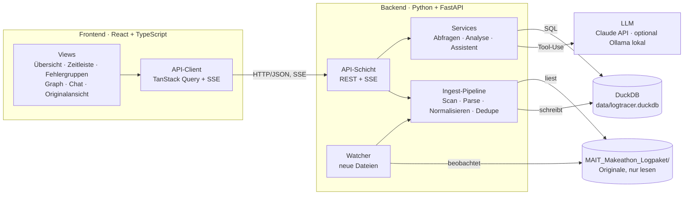
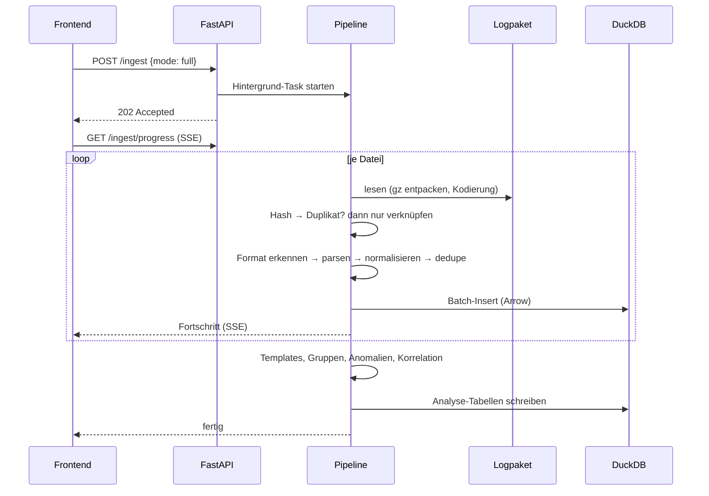
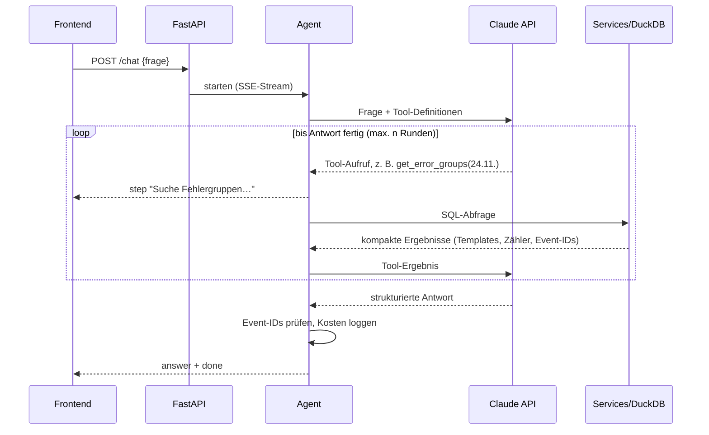
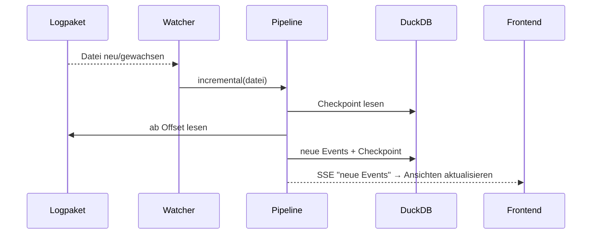
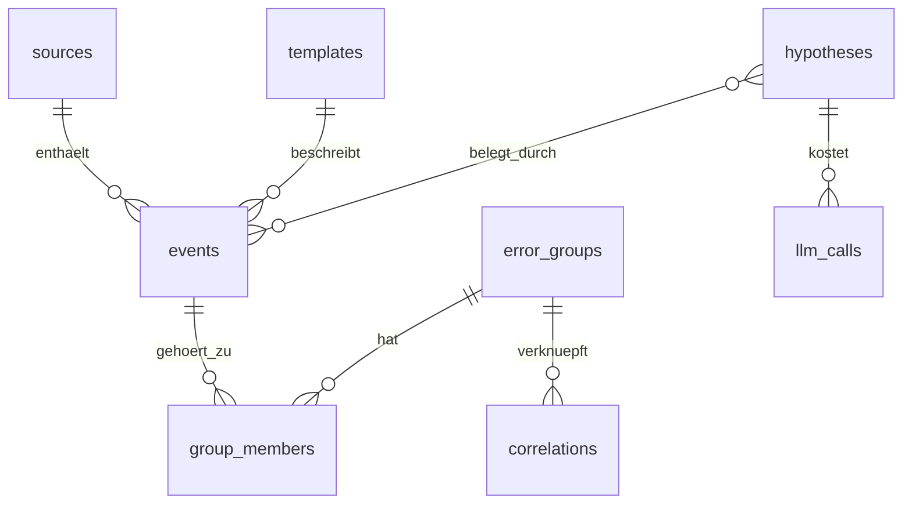

# Architektur: Log Tracer

> KI-Log-Assistent für die MAIT-Challenge · Stand: 23.11.2026 (Tag 1, Entwurf)
> Bezug: [plan.md](plan.md) · Englische Fassung: [ARCHITECTURE.md](ARCHITECTURE.md) · Datenbasis: `MAIT_Makeathon_Logpaket/` (nur lesen)

---

## 1. Überblick

Log Tracer ist in **zwei getrennte Anwendungen** aufgeteilt, die nur über eine HTTP-API miteinander sprechen:

| | **Frontend** | **Backend** |
|---|---|---|
| Aufgabe | Darstellung & Bedienung | Daten einlesen, analysieren, KI-Antworten erzeugen |
| Technik | React + TypeScript (Vite) | Python + FastAPI |
| Läuft auf | Browser (Dev-Server Port `5173`) | Server-Prozess (Port `8000`) |
| Kennt | nur die API (`/api/...`) | Logdateien, DuckDB, LLM |
| Zustand | keiner (nur UI-Zustand) | DuckDB-Datei, Checkpoints |

Das Frontend greift **nie direkt** auf Logdateien, DuckDB oder das LLM zu. Der API-Schlüssel für das LLM liegt nur im Backend.



### Architekturprinzipien

1. **Originale bleiben unverändert.** Logdateien werden nur gelesen. Alles Abgeleitete liegt in DuckDB und kann jederzeit neu gebaut werden.
2. **Jede Aussage hat einen Beleg.** Jedes Event kennt Datei und Zeile. Der Assistent darf nur Ursachen nennen, die er mit Event-IDs belegt.
3. **Das LLM liest nie alles.** Es holt sich Kontext gezielt über Tools (SQL-Abfragen). Das senkt Kosten und Halluzinationen.
4. **Erklärbare Analyse vor Blackbox.** Fehlergruppen, Anomalien und Korrelation sind regelbasiert oder statistisch und damit nachvollziehbar.
5. **Klare Schnittstelle.** Frontend und Backend teilen nur den API-Vertrag (OpenAPI). Beide Teams können parallel arbeiten.

---

## 2. Frameworks & Bibliotheken

### 2.1 Backend (Python 3.11+)

| Framework / Bibliothek | Was es ist | Wofür wir es nutzen |
|---|---|---|
| **FastAPI** | Web-Framework für APIs | REST-Endpunkte, automatische OpenAPI-Doku unter `/docs`, Validierung der Anfragen |
| **Uvicorn** | ASGI-Server | Startet die FastAPI-App |
| **Pydantic v2** + **pydantic-settings** | Datenmodelle mit Validierung | API-Schemas (Request/Response), Antwortformat des Assistenten, Konfiguration aus `.env` |
| **FastAPI-SSE** (`fastapi.sse`, eingebaut seit FastAPI 0.135) | Server-Sent Events über `EventSourceResponse` | Chat-Antworten und Ingest-Fortschritt live ans Frontend streamen; kein Zusatzpaket nötig |
| **DuckDB** | Eingebettete analytische SQL-Datenbank (eine Datei) | Speicher für Quellen, Events, Templates, Gruppen, Hypothesen, LLM-Kosten |
| **PyArrow** | Spaltenformat im Speicher | Schneller Bulk-Insert von Events in DuckDB (statt Zeile für Zeile) |
| **pandas** | Tabellen-Datenanalyse | Zeitfenster, Raten pro Minute, Baseline-Berechnung |
| **Drain3** | Online-Log-Template-Mining | Macht aus Meldungen Templates (`Timeout after <*> to <*>`) für Gruppierung. Hinweis: letzte Version 0.9.11 (2022), wird nicht mehr aktiv gepflegt; Installation an Tag 1 testen |
| **scikit-learn** | Machine-Learning-Bibliothek | Optional: Isolation Forest für Anomalien auf Template-Häufigkeiten |
| **networkx** | Graph-Bibliothek | Abhängigkeitsgraph der Server, Kausalketten als gerichteter Graph |
| **watchdog** | Dateisystem-Beobachtung | Erkennt neue oder wachsende Logdateien für inkrementellen Ingest |
| **anthropic** (SDK) | Client für die Claude API | LLM-Aufrufe mit Tool-Use, Token-Zählung für Kosten |
| **httpx** | HTTP-Client | Optionaler Ollama-Provider (lokales LLM), Tests der API |
| Standardbibliothek: `gzip`, `csv`, `json`, `xml.etree` (iterparse), `hashlib`, `zoneinfo` | | Entpacken, mehrzeilige CSV-Felder, XML streamen, Datei-Hashes, Zeitzonen |
| **tzdata** | IANA-Zeitzonendaten als Python-Paket | Für `zoneinfo` unter Windows nötig, weil Windows keine Zeitzonendatenbank mitbringt |
| **pytest**, **ruff** | Tests, Linter/Formatter | Parser-Tests je Format, einheitlicher Code-Stil |

### 2.2 Frontend (Node.js 22 oder 24 LTS; Node 20 hat im April 2026 sein Lebensende erreicht)

| Framework / Bibliothek | Was es ist | Wofür wir es nutzen |
|---|---|---|
| **React 19** + **TypeScript** | UI-Bibliothek mit Typisierung | Komponenten für alle Ansichten (aktuelle Mantine-Versionen setzen React 19 voraus) |
| **Vite** | Build-Tool & Dev-Server | Schneller Start, Hot Reload, Proxy `/api` → Backend |
| **TanStack Query** | Server-State-Management | Laden, Cachen und Aktualisieren der API-Daten |
| **React Router** | Routing | Seiten: Übersicht, Zeitleiste, Fehlergruppen, Graph, Chat |
| **Mantine** | UI-Komponentenbibliothek | Layout, Tabellen, Filter, Badges, Drawer, Dark Mode |
| **Apache ECharts** (`echarts-for-react`) | Chart-Bibliothek | Zeitleiste pro Server mit Zoom, Fehlerraten, Anomalie-Marker; performant bei vielen Punkten |
| **Cytoscape.js** (`react-cytoscapejs`) | Graph-Visualisierung | Abhängigkeitsgraph und Kausalkette. Der React-Wrapper wurde seit 2022 nicht mehr aktualisiert; bei Problemen `cytoscape` direkt in einer kleinen Komponente mit `useRef`/`useEffect` einbinden |
| **fetch-event-stream** (oder `fetch` + `ReadableStream`) | SSE-Client für POST-Anfragen | Der Chat-Stream kommt von `POST /chat`; das `EventSource` des Browsers kann nur GET |
| **react-markdown** | Markdown-Renderer | Chat-Antworten formatiert darstellen |
| **openapi-typescript** | Typ-Generator | TypeScript-Typen direkt aus der OpenAPI-Spezifikation des Backends |

> **Fallback bei Zeitnot:** Statt React ein **Streamlit**-Frontend, das ebenfalls *nur* die Backend-API aufruft. Die Trennung bleibt erhalten, nur die Oberfläche wird einfacher.

### 2.3 Externe Dienste

| Dienst | Rolle | Hinweis |
|---|---|---|
| **Claude API** (Anthropic) | LLM für den Assistenten (Tool-Use) | z. B. `claude-sonnet-5-5`; Schlüssel nur im Backend (`.env`) |
| **Ollama** (optional) | Lokales LLM | Datenschutz-Argument: keine Logs verlassen das Haus |

---

## 3. Backend-Komponenten

```
backend/src/logtracer/
├── api/            ← HTTP-Schicht (FastAPI-Router, Schemas)
├── services/       ← Anwendungslogik, die die API aufruft
├── ingest/         ← Logs finden, lesen, parsen
├── normalize/      ← Zeit, Level, Uhr-Korrektur, Dedupe
├── analysis/       ← Templates, Fehlergruppen, Anomalien, Korrelation
├── assistant/      ← LLM-Anbindung, Tools, Prompt, Antwortformat
├── storage/        ← DuckDB-Verbindung, Schema, Repositories
└── core/           ← Konfiguration, Logging, gemeinsame Modelle
```

### 3.1 `api/`: HTTP-Schicht

Dünne Schicht: nimmt Anfragen an, validiert sie mit Pydantic und ruft Services auf. Keine Logik.

| Router | Aufgabe |
|---|---|
| `ingest.py` | Ingest starten, Fortschritt (SSE), Status der Quellen |
| `events.py` | Events suchen/filtern, Einzelevent, Originalkontext |
| `analysis.py` | Fehlergruppen, Anomalien, Zeitreihen, Abhängigkeitsgraph |
| `chat.py` | Frage stellen (Antwort per SSE gestreamt), Verlauf |
| `eval.py` | Evaluationslauf starten, Metriken (Qualität & Kosten) |
| `health.py` | Lebenszeichen, Version, DB-Statistik |

### 3.2 `ingest/`: Einsammeln & Parsen

| Komponente | Was sie macht |
|---|---|
| `scanner.py` | Läuft rekursiv über das Logpaket, trennt Logs von Metadaten (`server_info.json`, `README.md`), leitet `server / application / component` aus dem Pfad ab |
| `fingerprint.py` | Berechnet SHA-256 je Datei (nach Entpacken). Byte-gleiche Kopien (`_runNN`) werden verknüpft statt neu geparst |
| `reader.py` | Öffnet Dateien: `.gz` im Speicher entpacken, Kodierung UTF-8 mit Fallback Windows-1252, CRLF/LF |
| `detector.py` | Erkennt das Format anhand Endung + ersten Zeilen und wählt den Parser |
| `parsers/kv_log.py` | `TS LEVEL host=… component=… … \| Text` |
| `parsers/bracket_json.py` | `TS [LEVEL] host=… \| {JSON}` |
| `parsers/csv_semicolon.py` | CSV mit `;`, mehrzeilige Felder (Stacktraces) über das `csv`-Modul |
| `parsers/jsonl.py` | Ein JSON-Objekt pro Zeile (auch `ki-integriert`, `.gz`) |
| `parsers/xml_events.py` | `<Events><Event>…` per `iterparse` (speicherschonend) |
| `parsers/freetext.py` | `import_*.log`: Datum+Zeit oder nur Uhrzeit (Datum aus Kontext), Folgezeilen anhängen |
| `checkpoint.py` | Merkt pro Datei Byte-Offset und Zeilennummer, liest beim nächsten Lauf nur Neues |
| `watcher.py` | watchdog-Beobachter. Meldet neue/geänderte Dateien an die Pipeline |
| `pipeline.py` | Orchestriert: scannen → lesen → parsen → normalisieren → deduplizieren → in DuckDB schreiben (Batches über PyArrow) |

**Ausgabe jedes Parsers:** ein einheitliches `RawEvent` (Pydantic) mit `ts_raw`, `level_raw`, `host`, `component`, `event_id`, `job_id`, `trace_id`, `session_id`, `message`, `attrs`, `line_start`, `line_end`, `raw`. Neue Formate brauchen nur einen neuen Parser, der Rest der Pipeline bleibt gleich.

### 3.3 `normalize/`: Vereinheitlichen

| Komponente | Was sie macht |
|---|---|
| `timestamps.py` | Alle Zeitformate → UTC (`ts_utc`), Original bleibt in `ts_raw` |
| `levels.py` | Level-Mapping auf `DEBUG/INFO/WARN/ERROR/FATAL` (`Critical`, `SEVERE` → `FATAL`, `WARNING` → `WARN` …) |
| `clock.py` | Erkennt Uhrabweichung pro Host (Hinweise wie `clock_offset`, oder systematischer Versatz zu Partner-Events mit gleicher `trace_id`/`job_id`) und setzt `clock_offset_s` |
| `dedupe.py` | Event-Fingerprint aus `host + event_id + ts_utc + message`. Duplikate werden markiert (`duplicate_of`), nicht gelöscht. Verspätete Einträge werden markiert |

### 3.4 `analysis/`: Verstehen

| Komponente | Was sie macht |
|---|---|
| `templates.py` | Drain3-Wrapper: vergibt `template_id` je Event, speichert Templates. Maskiert vorher IDs, Zahlen, Pfade |
| `error_groups.py` | Fasst WARN/ERROR/FATAL zu Gruppen zusammen (gleiches Template + Komponente + Zeitnähe). Bestimmt Status **„erholt"** (späterer Erfolg im selben Job/Trace) oder **„fehlgeschlagen"** |
| `anomalies.py` | Fehlerrate pro Server/Minute vs. Baseline (z-Score), neue/seltene Templates, Level-Sprünge, Ausreißer bei `duration_ms` |
| `correlation.py` | Verknüpft Gruppen über Server: hart (gleiche `trace_id`, `job_id` im Zeitfenster, Objekt-ID, `INC-xx`) und weich (Zeitnähe, Reihenfolge, `dependency=<host>`). Ergebnis: Kausalkette mit Konfidenz |
| `graph.py` | Baut mit networkx den Abhängigkeitsgraph der Server und die Kausalkette als gerichteten Graph |

### 3.5 `assistant/`: KI-Assistent

| Komponente | Was sie macht |
|---|---|
| `providers/` | Einheitliche Schnittstelle `LLMProvider` mit `ClaudeProvider` (Standard) und `OllamaProvider` (lokal). Umschaltbar per `.env` |
| `tools.py` | Tool-Definitionen für das LLM, jeweils ein Aufruf in `services/`: `search_events`, `get_error_groups`, `get_anomalies`, `trace`, `correlate`, `get_context` |
| `prompt.py` | System-Prompt: Rolle, Regeln (nur mit Belegen antworten, Unsicherheit nennen, harmlose ERRORs als solche erkennen), Antwortformat |
| `answer.py` | Pydantic-Schema der Antwort: `summary`, `causal_chain[]`, `affected_systems[]`, `evidence[]` (Event-IDs), `uncertainty`, `counter_evidence[]`, `verification_steps[]`, `recommendation`. Prüft, dass jede genannte Event-ID existiert |
| `agent.py` | Tool-Use-Schleife: Frage → LLM → Tool-Aufrufe → Ergebnisse → … → strukturierte Antwort. Begrenzung der Runden und Token |
| `masking.py` | Optionaler PII-Filter vor dem LLM-Aufruf (Benutzer, IPs, Pfade) |
| `costs.py` | Schreibt pro Aufruf Tokens, Dauer und geschätzte Kosten in `llm_calls` |

### 3.6 `services/`: Anwendungslogik

Verbindet API, Analyse und Speicher. Wird von der API **und** von den LLM-Tools genutzt, damit beide dieselben Abfragen verwenden.

| Service | Aufgabe |
|---|---|
| `ingest_service.py` | Voll- und Teil-Ingest starten, Fortschritt melden |
| `event_service.py` | Suche, Filter, Paginierung, Originalkontext (±n Zeilen aus der Quelldatei bzw. aus DuckDB) |
| `analysis_service.py` | Zeitreihen, Gruppen, Anomalien, Graph abfragen bzw. neu berechnen |
| `chat_service.py` | Startet den Agenten, streamt Zwischenschritte und Antwort, speichert Hypothesen |
| `eval_service.py` | Spielt `eval/questions.yaml` durch und vergleicht mit der richtigen Antwort, berechnet Metriken |

### 3.7 `storage/`: Datenhaltung

| Komponente | Was sie macht |
|---|---|
| `db.py` | Öffnet **eine** DuckDB-Verbindung pro Prozess. Lesende Zugriffe über `cursor()` |
| `schema.sql` | Tabellen: `sources`, `events`, `templates`, `error_groups`, `group_members`, `anomalies`, `correlations`, `incidents`, `hypotheses`, `llm_calls`, `chat_messages` |
| `repositories/` | Gekapselte SQL-Abfragen je Tabelle, damit kein SQL in API oder Services verstreut ist |

> **Wichtig zu DuckDB:** Eine normale Datenbankdatei öffnet entweder **ein Prozess** lesend und schreibend, oder mehrere Prozesse nur lesend. Neuere DuckDB-Versionen bieten zusätzliche Wege für Schreibzugriffe aus mehreren Prozessen, die wir nicht brauchen. Darum laufen API, Ingest und Watcher im **selben Backend-Prozess** (Watcher und Ingest als Hintergrund-Tasks). Skripte wie `scripts/ingest.py` laufen nur, wenn das Backend gestoppt ist, oder rufen die API auf.

---

## 4. Frontend-Komponenten

```
frontend/src/
├── api/            ← generierte Typen + API-Client
├── pages/          ← eine Datei pro Seite
├── components/     ← wiederverwendbare Bausteine
├── hooks/          ← Datenabfragen (TanStack Query), SSE
└── App.tsx         ← Layout, Navigation, Routing
```

### 4.1 Seiten (`pages/`)

| Seite | Was sie zeigt | Nutzt API |
|---|---|---|
| **Übersicht** | Kacheln: Server, Events, ERRORs, offene Fehlergruppen, Ingest-Status; Liste der Vorfälle (verknüpfte Fehlergruppen) und auffälliger Server | `/api/stats`, `/api/analysis/incidents`, `/api/analysis/groups` |
| **Zeitleiste** | Eine Spur pro Server, Fehlerrate + Anomalie-Marker, Zoom; Klick öffnet Events im Zeitraum | `/api/analysis/timeseries`, `/api/events` |
| **Fehlergruppen** | Tabelle: Template, Server, Anzahl, Zeitraum, Status (erholt/fehlgeschlagen), verknüpfte Gruppen | `/api/analysis/groups` |
| **Abhängigkeiten** | Graph der Server; Kanten aus `dependency=` und Korrelationen; Kausalkette hervorgehoben | `/api/analysis/graph` |
| **Assistent (Chat)** | Frage stellen, Zwischenschritte („suche in teamcenter_db…"), strukturierte Antwort mit Belegen, Unsicherheit, Prüfschritten | `/api/chat` (SSE) |
| **Qualität & Kosten** | Trefferquote der Testfragen, Tokens und € pro Frage, Vergleich „alles ins LLM" vs. „Tools" | `/api/eval/*` |

### 4.2 Bausteine (`components/`)

| Komponente | Aufgabe |
|---|---|
| `FilterBar` | Server, Komponente, Level, Zeitraum, Job/Trace-ID; Zustand in der URL (teilbare Links) |
| `EventTable` | Virtualisierte Liste vieler Events mit Level-Farben |
| `EvidenceChip` | Beleg `[server · datei:zeile · zeit]`, Klick öffnet `SourceViewer` |
| `SourceViewer` | Drawer mit Originalzeilen ±n um das Event, Treffer hervorgehoben, Dateipfad |
| `CausalChain` | Kette als Schritte (Server → Ereignis → Folge) mit Konfidenz |
| `AnswerCard` | Gliedert die Antwort: Zusammenfassung, Kette, Systeme, Belege, Unsicherheit, Prüfschritte |
| `IngestProgress` | Fortschrittsbalken per SSE, Hinweis bei neu erkannten Dateien |

---

## 5. API-Vertrag (Entwurf)

Basis: `http://localhost:8000/api`, OpenAPI unter `/docs`. JSON, Zeiten immer ISO-8601 UTC.

| Methode | Pfad | Zweck |
|---|---|---|
| `GET` | `/health` | Lebenszeichen, Version |
| `GET` | `/stats` | Zählwerte: Quellen, Events, Duplikate, Level-Verteilung |
| `POST` | `/ingest` | Ingest starten (`mode: full \| incremental`) |
| `GET` | `/ingest/progress` | **SSE**: Fortschritt, neue Dateien |
| `GET` | `/sources` | Quellen mit Format, Kodierung, Duplikat-Status, Checkpoint |
| `GET` | `/events` | Suche: `server, component, level, from, to, q, job_id, trace_id, page` |
| `GET` | `/events/{id}` | Einzelevent mit allen Feldern |
| `GET` | `/events/{id}/context?n=10` | Originalzeilen um das Event |
| `GET` | `/analysis/timeseries` | Events/Fehler pro Server und Zeitfenster |
| `GET` | `/analysis/groups` | Fehlergruppen mit Status und Verknüpfungen |
| `GET` | `/analysis/incidents` | Vorfälle: über Server verknüpfte Fehlergruppen mit Zeitraum und Status |
| `GET` | `/analysis/anomalies` | Anomalien im Zeitraum |
| `GET` | `/analysis/graph` | Knoten & Kanten für den Abhängigkeitsgraph |
| `GET` | `/trace/{key}` | Alle Events einer Kette (`job_id`, `trace_id`, Objekt-ID) |
| `POST` | `/chat` | Frage stellen. Antwort als **SSE**: `step` (Tool-Aufruf), `token` (Text), `answer` (strukturiert), `done`. Das Frontend liest den Stream mit `fetch` (z. B. `fetch-event-stream`), weil `EventSource` keine POST-Anfragen senden kann |
| `GET` | `/chat/{conversation_id}` | Verlauf |
| `POST` | `/eval/run` | Evaluationslauf starten |
| `GET` | `/eval/results` | Metriken: Trefferquote, Kosten, Antwortzeit |

**Beispiel: strukturierte Antwort (`answer`-Event)**

```json
{
  "summary": "Das Publish von JOB-2003 schlug fehl, weil FMS den JT-Upload abgelehnt hat (Dienstbenutzer DEMO-SERVICE fehlt WRITE_DATASET auf dem Ziel-Volume), obwohl der Konverter Erfolg meldete.",
  "causal_chain": [
    {"step": 1, "server": "mait_win03_cad_converter", "event_ids": [1001], "text": "Konvertierung erfolgreich; JT-Ausgabe DEMO-301.jt"},
    {"step": 2, "server": "mait_win04_plm_sync", "event_ids": [1002], "text": "FMS-Client: Ergebnis-Upload für DEMO-SERVICE verweigert; permission=WRITE_DATASET"},
    {"step": 3, "server": "mait_linux1_teamcenter_app", "event_ids": [1003], "text": "FMS-Server-Cache: Upload abgelehnt, Zugriffsrichtlinie ohne Schreibrecht auf dem Ziel-Volume"},
    {"step": 4, "server": "mait_linux1_teamcenter_app", "event_ids": [1004], "text": "Publish-Task fehlgeschlagen: kein registriertes Ergebnis; converter status=SUCCESS"}
  ],
  "affected_systems": ["mait_win03_cad_converter", "mait_win04_plm_sync", "mait_linux1_teamcenter_app"],
  "evidence": [
    {"event_id": 1001, "file": "mait_win03_cad_converter/logs/converter/nx_jt/creative_2026-11-24.csv", "line": 31, "ts": "2026-11-24T08:30:00Z"},
    {"event_id": 1002, "file": "mait_win04_plm_sync/logs/fms/fcc/creative_2026-11-24.jsonl.gz", "line": 29, "ts": "2026-11-24T08:30:04Z"},
    {"event_id": 1003, "file": "mait_linux1_teamcenter_app/logs/fms/fsc/creative_2026-11-24.txt", "line": 29, "ts": "2026-11-24T08:30:08Z"},
    {"event_id": 1004, "file": "mait_linux1_teamcenter_app/logs/teamcenter/workflow/creative_2026-11-24.jsonl", "line": 30, "ts": "2026-11-24T08:30:12Z"}
  ],
  "confidence": 0.85,
  "uncertainty": "Kein Log zeigt, warum DEMO-SERVICE das Schreibrecht fehlt (geänderte Richtlinie oder neues Volume).",
  "counter_evidence": ["Der Konverter meldet SUCCESS, die Konvertierung selbst ist also nicht die Ursache"],
  "verification_steps": ["Zugriffsrichtlinie des FMS-Volumes für DEMO-SERVICE prüfen", "Prüfen, ob um 08:30 weitere Uploads auf dasselbe Volume fehlschlugen"],
  "recommendation": "Schreibrecht auf dem Ziel-Volume vergeben, danach den Publish-Task neu anstoßen."
}
```

*(Kette, Dateien, Zeilen und Zeiten stammen aus dem Logpaket; die Event-IDs sind Platzhalter für die internen DuckDB-IDs.)*

---

## 6. Abläufe

### 6.1 Ingest (voll)



### 6.2 Frage an den Assistenten



### 6.3 Neue Logdatei (kontinuierlich)



---

## 7. Datenmodell (Kurzfassung)

Details in [plan.md §8](plan.md).



| Tabelle | Inhalt |
|---|---|
| `sources` | Datei, Server, OS, Rolle, Format, Kodierung, Hash, Duplikat-Verweis, Checkpoint |
| `events` | ein Logeintrag mit Rückverweis (Datei, Zeile), `ts_raw/ts_utc`, Level, Schlüssel-IDs, Text, `attrs`, `template_id`, Duplikat-Verweis |
| `templates` | Drain3-Templates mit Häufigkeit |
| `error_groups`, `group_members` | Gruppen gleicher Ursache, Status erholt/fehlgeschlagen |
| `anomalies` | Zeitfenster, Server, Art, Score |
| `correlations` | Verknüpfung zweier Gruppen mit Art (hart/weich) und Konfidenz |
| `hypotheses` | gespeicherte Antworten des Assistenten |
| `llm_calls` | Tokens, Dauer, Kosten pro Aufruf |
| `chat_messages` | Chatverlauf |

---

## 8. Repo-Struktur

```
makeathon/
├── AGENTS.md · CLAUDE.md
├── docs/
│   ├── plan.md · plan.en.md        # Plan (Deutsch, Englisch)
│   ├── AI_LOG.md · WORKLOG.md      # Arbeitslogs
│   ├── ARCHITEKTUR.md              # Deutsch
│   └── ARCHITECTURE.md             # Englisch
├── MAIT_Makeathon_Logpaket/        # Originaldaten (nicht im Git)
├── data/logtracer.duckdb             # abgeleitet (nicht im Git)
├── eval/questions.yaml             # Testfragen + richtige Antworten
├── backend/
│   ├── pyproject.toml
│   ├── .env.example                # LOG_ROOT, DB_PATH, LLM_PROVIDER, ANTHROPIC_API_KEY
│   ├── src/logtracer/
│   │   ├── main.py                 # FastAPI-App, Router, Hintergrund-Tasks
│   │   ├── api/ services/ ingest/ normalize/
│   │   ├── analysis/ assistant/ storage/ core/
│   ├── scripts/                    # ingest.py, evaluate.py (CLI)
│   └── tests/                      # Parser-Tests mit echten Beispielzeilen
└── frontend/
    ├── package.json
    ├── vite.config.ts              # Proxy /api → localhost:8000
    └── src/
        ├── api/ pages/ components/ hooks/
        └── App.tsx
```

---

## 9. Betrieb & Entwicklung

### Lokal starten

```powershell
cd backend; uv sync; uv run uvicorn logtracer.main:app --reload --port 8000
```

```powershell
cd frontend; npm install; npm run dev
```

Das Frontend läuft auf `http://localhost:5173` und leitet `/api` an das Backend weiter. Die API-Doku liegt unter `http://localhost:8000/docs`.

### Konfiguration (`backend/.env`)

| Variable | Bedeutung |
|---|---|
| `LOG_ROOT` | Pfad zum Logpaket (z. B. `../MAIT_Makeathon_Logpaket`) |
| `DB_PATH` | Pfad zur DuckDB-Datei (`../data/logtracer.duckdb`) |
| `LLM_PROVIDER` | `claude` oder `ollama` |
| `ANTHROPIC_API_KEY` | Schlüssel für die Claude API (nur Backend, nie ins Git) |
| `LLM_MODEL` | Modell-ID, z. B. `claude-sonnet-5-5` |
| `WATCH_ENABLED` | Watcher an/aus |

### Typen synchron halten

Das Backend erzeugt `openapi.json`. Das Frontend erzeugt daraus mit `openapi-typescript` seine Typen. Ändert sich ein Endpunkt, sehen beide Seiten das sofort als Typfehler.

---

## 10. Querschnittsthemen

| Thema | Umsetzung |
|---|---|
| **Nachvollziehbarkeit** | Jedes Event mit `source_id`, `line_start/line_end`, `raw`. Antworten nur mit prüfbaren Event-IDs |
| **Datenschutz** | Logs bleiben lokal. Ans LLM gehen nur ausgewählte Ausschnitte. Optional Masking und lokales LLM (Ollama) |
| **Performance** | Datei-Dedupe vor dem Parsen (ca. 60 % Kopien), Arrow-Batch-Inserts, Indizes auf `ts_utc`, `host`, `job_id`, `trace_id`, DB vor dem Pitch vorbauen |
| **Robustheit** | Unlesbare Zeilen landen als `unparsed` mit Rohtext, statt den Ingest abzubrechen |
| **Kosten** | Kontextauswahl über Tools, begrenzte Runden, Kosten pro Frage in `llm_calls` |
| **Qualität** | Parser-Tests je Format; Evaluationslauf mit Testfragen als Regressionstest für Prompt-Änderungen |
| **Sicherheit** | API-Schlüssel nur im Backend, CORS nur für das Frontend, keine Dateipfade aus Nutzereingaben ungeprüft öffnen |

---

## 11. Architekturentscheidungen

| # | Entscheidung | Begründung | Alternative |
|---|---|---|---|
| E1 | Frontend und Backend getrennt über REST/SSE | Paralleles Arbeiten, klare Verantwortung, LLM-Schlüssel bleibt im Backend | Streamlit-Monolith (schneller, aber vermischt) |
| E2 | DuckDB statt Server-Datenbank | Eine Datei, kein Setup, schnelle Aggregationen | PostgreSQL, ClickHouse, Elastic (für Produktion) |
| E3 | Ein Backend-Prozess für API, Ingest und Watcher | DuckDB erlaubt nur einen schreibenden Prozess | Separater Worker + Server-DB |
| E4 | LLM nur über Tools, nie Rohlogs komplett | Kosten, Genauigkeit, Belegbarkeit | Ganze Dateien in den Kontext (Vergleichswert in der Evaluation) |
| E5 | Regelbasierte/statistische Analyse vor ML | Erklärbar, schnell gebaut, in 3 Tagen testbar | Deep-Learning-Anomalieerkennung |
| E6 | SSE statt WebSockets | Nur Server → Client nötig, einfacher; `GET`-Streams über `EventSource`, der `POST /chat`-Stream über `fetch` | WebSockets |
| E7 | Provider-Schnittstelle für das LLM | Claude für Qualität, Ollama für Datenschutz-Demo | Fest verdrahteter Anbieter |

## 12. Offene Punkte

- Fehlende Doku `FORMATE.md` / `INTEGRATION.md` (Zeitzonen, T4S/T4EA-Begriffe) beim Mentor anfragen
- Vorgaben zum LLM (Cloud erlaubt?) klären, davon hängt der Standard-Provider ab
- Teamgröße und Frontend-Erfahrung: React oder Streamlit-Fallback am Tag 1 entscheiden
